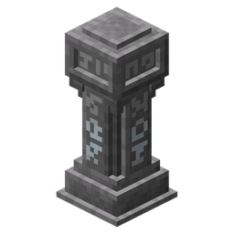
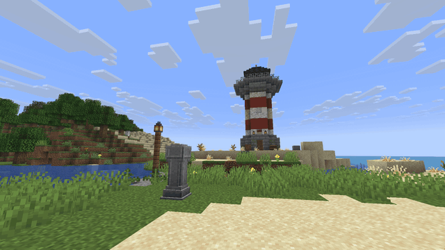
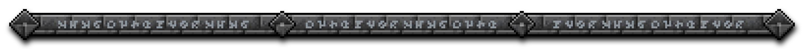
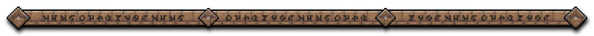
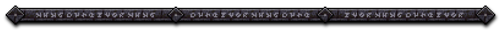

# Traveler's Waystones

**Teleport between the places you've been!**

**Traveler's Waystones** adds waystones which allow you to teleport between the places you've been. Discover waystones
on your travels and teleport between them through a screen where you can search your waystones, mark your favorites and
see where each waystone is. Waystones work at any distance and across dimensions, and the Warp Pendant
teleports you to your waystones from anywhere.

### Features
- Waystones in 19 different stone types
- Claim a waystone by giving it a name, other players discover it by right-clicking it
- A teleport screen with search, favorites and a 3D preview of each waystone
- The Warp Pendant opens the teleport screen from anywhere (right-click it or press `K`), also from a Curios or
  Trinkets slot
- Warnings before teleporting to a waystone without a safe spot around it
- Waystones are protected from accidental breaking and can be moved up to 10 blocks by their owner

For the full description and recipes, see the  [Modrinth](https://modrinth.com/mod/travelers-waystones)
or  [CurseForge](https://www.curseforge.com/minecraft/mc-mods/travelers-waystones) page.

### For Developers
See the [wiki](https://github.com/SuperMartijn642/TravelersWaystones/wiki) for how to add the API as a dependency and for
examples, such as a map integration. The API is in `com.supermartijn642.travelerswaystones.api`:
- `WaystoneType` lets you register your own blocks as waystones and choose where players arrive
- `WaystoneEvents` lets you allow or deny claiming, discovering, moving and teleporting, and listen for changes to
  waystones
- `GlobalWaystoneManager` and `PersonalWaystoneManager` give access to all waystones and to the ones each player has
  discovered, also on the client
- `DiscoveredWaystoneTarget#teleport` teleports a player and `PersonalWaystoneManager#openTeleportScreen` opens the
  teleport screen

The API is the same on every version, apart from Minecraft's own class renames. Missing something? Feel free to open an
issue request for it.

### Issues and Suggestions
Found a bug or have a suggestion? Please open an [issue](https://github.com/SuperMartijn642/TravelersWaystones/issues).

For questions and discussion, feel free to join the SuperMartijn642 discord server!

